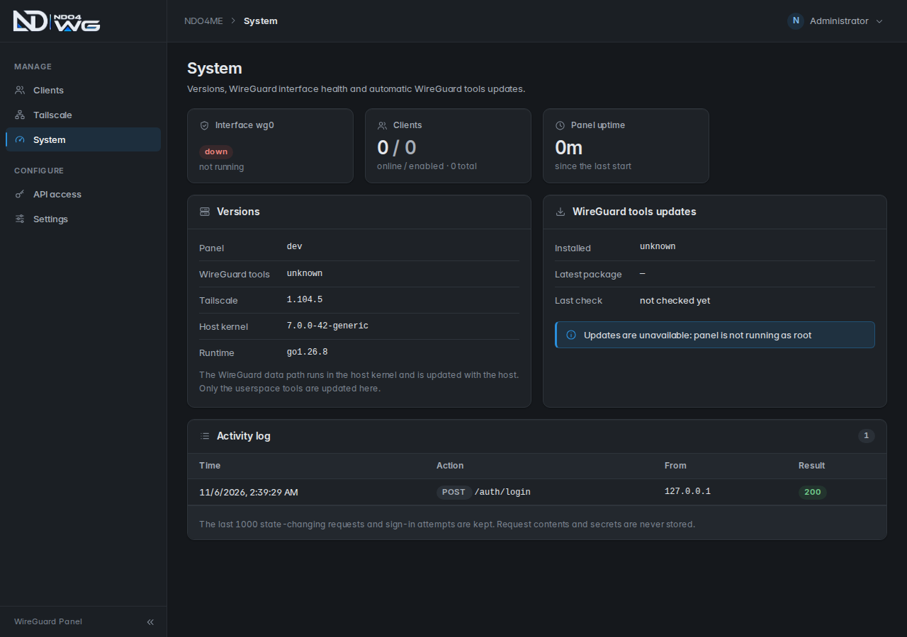

<div align="center">


# NDO4 WG

**A modern, self-hosted WireGuard panel with Tailscale built in.**<br>
One container. Automatic updates. Secure by default.

[](https://github.com/NDO4ME/wireguard-server-panel/actions/workflows/docker-publish.yml)
[](https://github.com/NDO4ME/wireguard-server-panel/actions/workflows/ci.yml)
[](LICENSE)

[Quick start](#quick-start) · [Features](#why-ndo4-wg) · [Updating](DEVELOPER.md#updating) · [Documentation](DEVELOPER.md)



</div>

## Why NDO4 WG

| | |
|---|---|
| **Clients in seconds** | Create a client, scan the QR code or download the config. Set an optional expiry date and a note; expired clients are switched off automatically. |
| **Tailscale included** | Route your VPN clients into your tailnet, advertise subnets, become an exit node, or raise the shields, all from the panel. [Details](DEVELOPER.md#tailscale) |
| **Stays up to date** | WireGuard tools and Tailscale update themselves from the official stable channels. Tunnels stay connected and a failed update rolls back on its own. [How it works](DEVELOPER.md#automatic-updates) |
| **Secure by default** | Listens on localhost only, random admin password, random API token, hardened container, activity log. [Security](DEVELOPER.md#security-notes) |
| **Works behind your proxy** | Ready for Caddy with automatic HTTPS, or run it locally. [Caddy setup](DEVELOPER.md#reverse-proxy-caddy) |
| **Make it yours** | White-label login page: your logo, heading and accent colour, nothing else. Endpoint can be a hostname, so a new server IP never breaks existing configs. |
| **REST API** | Everything the panel does is available to your scripts. [API reference](DEVELOPER.md#rest-api) |
| **Easy backups** | One click downloads a consistent snapshot. [Backup and restore](DEVELOPER.md#backup-and-restore) |

## Quick start

You need Docker and a Linux host with WireGuard support.

```bash
git clone https://github.com/NDO4ME/wireguard-server-panel.git
cd wireguard-server-panel

export ADMIN_PASSWORD='use-a-long-random-password'
docker compose up -d
```

The panel listens on `http://127.0.0.1:1881`. Put it behind Caddy for HTTPS with the ready-made [`deploy/Caddyfile`](deploy/Caddyfile), then sign in as `ndo4me`.

Prefer `docker run`? See the [full installation guide](DEVELOPER.md#quick-start).

## Update

```bash
docker compose pull && docker compose up -d
```

Your data lives in a volume and is kept. Coming from an older version or a `docker run` install? Follow the [step-by-step update guide](DEVELOPER.md#updating), including [rollback](DEVELOPER.md#roll-back).

## Documentation

| Topic | |
|---|---|
| Installation and configuration | [Quick start](DEVELOPER.md#quick-start) · [Environment variables](DEVELOPER.md#configuration) |
| Using the panel | [Usage](DEVELOPER.md#usage) · [REST API](DEVELOPER.md#rest-api) |
| Tailscale | [Connect and route](DEVELOPER.md#connect-and-route) · [Node options](DEVELOPER.md#node-options) · [Automatic updates](DEVELOPER.md#automatic-updates) |
| Operations | [Updating](DEVELOPER.md#updating) · [Caddy](DEVELOPER.md#reverse-proxy-caddy) · [Backup](DEVELOPER.md#backup-and-restore) · [Troubleshooting](DEVELOPER.md#troubleshooting) |
| Security | [Security notes](DEVELOPER.md#security-notes) |
| Contributing | [Architecture](DEVELOPER.md#architecture) · [Development](DEVELOPER.md#development) · [CI/CD](DEVELOPER.md#cicd) |

## License

MIT, see [LICENSE](LICENSE).
